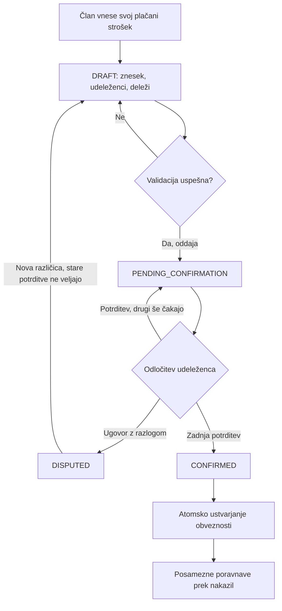
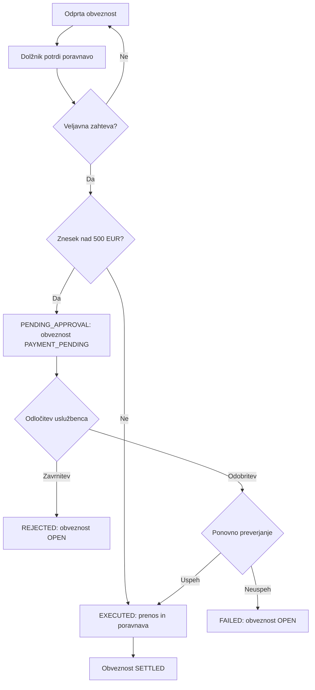

# MiniBank – funkcionalnosti in obseg

## Uporabniške vloge in zasebnost

| Sistemska vloga | Dovoljene dejavnosti | Omejitve |
| --- | --- | --- |
| Komitent (`CUSTOMER`) | Pregled svojih računov in nakazil, interna nakazila, ustvarjanje skupin, sprejem povabil, prijava lastnih plačanih stroškov, odločanje o svojih deležih in poravnava svojih obveznosti. | Ne vidi tujih bančnih stanj ali nepovezanih nakazil; ne potrjuje za druge, ne odobrava bančnih nakazil in ne upravlja sistemskih vlog. |
| Bančni uslužbenec (`CLERK`) | Čakalna vrsta nakazil nad 500 EUR, odobritev ali zavrnitev z razlogom, pregled nakazil, o katerih je sam odločil. | Ne oddaja nakazil za komitente, ne ureja zneskov ali prejemnikov, ne vidi skupinskih stroškov, članstev ali splošnega prometa računov. |
| Administrator (`ADMIN`) | Ustvarjanje dostopov, dodelitev sistemske vloge, deaktivacija in ponovna aktivacija uporabnikov. | Ne vidi finančnih ali skupinskih podatkov, ne izvaja in ne odobrava nakazil ter ne spreminja stanj. |

Znotraj skupine ima aktivni član pravico `ORGANIZER` ali `MEMBER`. Ustvarjalec je edini organizator skupine in lahko vabi obstoječe aktivne komitente po natančnem e-poštnem naslovu. Vsi aktivni člani lahko vnašajo svoje stroške. Organizator ne more spreminjati stroškov drugih. Komitent je lahko organizator ene in navaden član druge skupine.

Povabljeni vidi naziv skupine in ime organizatorja, pred sprejemom pa ne članov, stroškov ali obveznosti. Po sprejemu aktivni člani vidijo celotno zgodovino oddanih skupinskih predlogov, tudi pred svojim prihodom; na to jih opozori zaslon povabila. Neoddane osnutke vidi samo njihov avtor. Novi član ni samodejno dodan k obstoječim razdelitvam. Člani vidijo skupinske zneske in povzetek stanja poravnav, ne izvornih računov drugih, bančnih stanj ali razlogov bančne zavrnitve. Podrobnosti nakazila vidi pošiljatelj, prejemnik šele po izvedbi, uslužbenec pa v okviru obravnave.

Backend pravice preverja pri vsaki zahtevi. Deaktivacija onemogoči tudi uporabo odprte seje, ne izbriše članstev ali dolgov. Vloge komitenta z računi ali članstvi ni mogoče spremeniti. Zadnjega aktivnega administratorja ni mogoče deaktivirati ali mu odvzeti vloge.

## Predvidene funkcionalnosti

Predvidenih je **15 funkcionalnosti**, od tega **7 MVP**. F03–F07 so značilne za skupinsko upravljanje stroškov; F02 vključuje bančni odobritveni proces. Oznake veljajo za posodobljeno zasnovo in nadomeščajo prejšnjo razvrstitev.

| ID | Funkcionalnost in pričakovano vedenje | Obseg |
| --- | --- | --- |
| F01 | Finančni pregled lastnih računov, zadnjih 20 izvedenih nakazil za račun ter statusa in zgodovine lastnih oddanih nakazil. | **MVP** |
| F02 | Interna nakazila: validacija, prag 500 EUR, čakalna vrsta uslužbenca, odobritev ali zavrnitev, atomska izvedba in zaščita pred podvajanjem. | **MVP** |
| F03 | Skupine in povabila: ustvarjanje skupine, povabilo obstoječega komitenta, sprejem ali zavrnitev ter dostop glede na članstvo. | **MVP** |
| F04 | Razdelitev lastnega plačanega stroška med izbrane člane: enakomerni ali ročni deleži, preverjanje vsote in določen način razdelitve preostalih centov. | **MVP** |
| F05 | Soglasje o razdelitvi: potrditev lastnega deleža ali ugovor z razlogom, nova različica po ugovoru in nastanek obveznosti šele po soglasju vseh. | **MVP** |
| F06 | Pregled potrjenih obveznosti: kdo komu dolguje, odprti in poravnani zneski, nakazila v obravnavi ter neto položaj člana v skupini. | **MVP** |
| F07 | Celotna poravnava posamezne obveznosti z lastnega računa; povezava z nakazilom, preprečitev dvojnega plačila in uskladitev šele ob uspešni izvedbi. | **MVP** |
| F08 | Predlog poenostavljenih poravnav iz neto položajev članov s soglasjem vseh prizadetih in povezavami na prvotne obveznosti. | Kasnejša nadgradnja |
| F09 | Delna poravnava obveznosti z evidenco več izvedenih nakazil in preostanka. | Kasnejša nadgradnja |
| F10 | Ponavljajoči se skupni stroški: mesečna predloga pripravi nov osnutek za pregled plačnika in potrditev članov. | Kasnejša nadgradnja |
| F11 | Skupinski proračun: primerjava načrtovanega zneska s potrjenimi stroški obdobja in kategorijami porabe. | Kasnejša nadgradnja |
| F12 | Informativni skupni cilj: ciljna vrednost, rok ter ročno evidentirani lastni prispevki članov, brez prenosa ali rezervacije denarja. | Kasnejša nadgradnja |
| F13 | Obvestila znotraj aplikacije o potrebnih potrditvah, izidu poravnave in zapadlosti obveznosti z določenim rokom. | Kasnejša nadgradnja |
| F14 | Zaključek skupine in odhod člana ob poravnanih obveznostih ter brez nerešenih predlogov ali čakajočih nakazil. | Kasnejša nadgradnja |
| F15 | Izvoz obračuna skupine za obdobje v CSV s potrjenimi stroški, deleži, izvedenimi poravnavami in preostankom na izbrani presečni čas. | Kasnejša nadgradnja |

F08–F15 so osem možnih kasnejših nadgradenj; njihove zgodbe opredeljujejo prve omejene izvedbe. Prijava, odjava, CSRF, avtorizacija, administracija dostopov in validacija so obvezna skupna podlaga MVP, ne dodatne domenske funkcionalnosti. Javne registracije ni. [Uporabniške zgodbe](05-uporabniske-zgodbe.md) vsebujejo US-01–US-15 za F01–F15 ter tri podporne zgodbe za odobritve, administracijo in prijavo.

## Pravila skupinskih stroškov

1. Strošek ima enega plačnika, ki je tudi avtor in aktivni član skupine. Vnese naziv, datum, kategorijo (`FOOD`, `TRANSPORT`, `ACCOMMODATION`, `HOUSEHOLD`, `OTHER`), pozitiven znesek in svoj račun za povračila. Gre za evidenco že plačanega stroška zunaj aplikacije; datum ob oddaji ne sme biti v prihodnosti glede na Europe/Ljubljana.
2. Plačnik je vključen v razdelitev; njegov delež je lahko nič. Vsaj en drug vključeni aktivni član ima pozitiven delež. Člani z ničelnim deležem prav tako potrdijo sodelovanje. MVP nima več plačnikov, odstotkov ali delitve po utežeh.
3. Vsota deležev je natančno enaka strošku. Zneski imajo največ dve decimalki. Pri enakomerni delitvi sistem deli cele cente, preostale cente pa po enega dodeli članom po naraščajočem UUID. Vrstni red je fiksen in pred oddajo viden. Za 10,00 EUR med tri člane so deleži 3,34, 3,33 in 3,33 EUR.
4. Osnutek lahko ureja samo avtor. Oddaja ustvari nespremenljiv predlog z deleži; avtorjeva potrditev se zabeleži samodejno. Ostali odločijo samo o svojem deležu. Ob ugovoru je obvezna obrazložitev; predlog dobi stanje `DISPUTED` in nadaljnje potrjevanje je ustavljeno.
5. Avtor iz spornega predloga ustvari novo različico osnutka, stara dobi `SUPERSEDED`. Nove potrditve se ne dedujejo. Avtor lahko osnutek, čakajoči ali sporni predlog prekliče, dokler ni potrjen. Potrjenega stroška v MVP ni mogoče spreminjati, preklicati ali brisati.
6. Zadnja potrebna potrditev v eni transakciji potrdi različico in ustvari po eno obveznost za vsakega drugega člana s pozitivnim deležem. Upnik je plačnik. Ne nastane obveznost do samega sebe. Sočasne potrditve obveznosti ne podvojijo.
7. Obveznosti in bančna stanja so ločeni podatki. Nepovezano ročno nakazilo ne poravna obveznosti samodejno; za to se uporabi »Poravnaj obveznost«.

### Delovni proces: dogovor in nastanek obveznosti

Prejšnja različica ob nastanku nove dobi `SUPERSEDED`. Iz `DRAFT`, `PENDING_CONFIRMATION` ali `DISPUTED` je možen tudi prehod v `CANCELLED`; ta ne ustvari obveznosti. Status potrjene različice ostane `CONFIRMED` tudi po plačilih; odprtost dolga se računa ločeno.

## Delovni proces: nakazilo in poravnava

1. Komitent odda navadno nakazilo ali zahtevo za poravnavo konkretne obveznosti, vedno z enoličnim ključem. Pri poravnavi backend iz obveznosti določi upnika, ciljni račun in celotni znesek. Odjemalec izbira samo svoj izvorni račun.
2. Sistem preveri aktivnost lastnikov, lastništvo in različnost računov, pozitiven znesek, razpoložljiva sredstva in zgornjo mejo ciljnega stanja. Pri poravnavi preveri tudi dolžnika in odsotnost izvedenega ali čakajočega plačila iste obveznosti.
3. Vhodna poslovna napaka vrne napako brez novega nakazila. Do vključno 500,00 EUR uspešno neposredno nakazilo atomarno spremeni obe stanji in dobi `EXECUTED`. Nad pragom dobi `PENDING_APPROVAL`, brez bremenitve ali rezervacije sredstev.
4. Uslužbenec lahko čakajoče nakazilo zavrne z razlogom (`REJECTED`) ali ga odobri. Odobritev in izvedba sta ista podatkovna transakcija; ni trajnega vmesnega statusa »odobreno«.
5. Po zaklepanju se ponovno preverijo status, aktivnost, sredstva in dovoljeno ciljno stanje. Uspeh pomeni `EXECUTED`. Poslovna ovira ob odobritvi pomeni `FAILED`, brez prenosa. Tehnična napaka razveljavi transakcijo; čakajoče nakazilo ostane čakajoče.
6. Obveznost je `SETTLED` le, če ima povezano izvedeno nakazilo. Povezano čakajoče nakazilo pomeni `PAYMENT_PENDING`, sicer je `OPEN`. Po `FAILED` ali `REJECTED` lahko dolžnik odda novo zahtevo z novim ključem. Staro nakazilo in njegova zgodovina ostaneta nespremenjena.

Ponovitev istega ključa in vsebine vrne isto nakazilo; spremenjena vsebina z istim ključem vrne konflikt. Tudi dva različna ključa ne smeta omogočiti dvojne poravnave. MVP ne omogoča preklica čakajočega nakazila ali avtomatskega pobota med obveznostmi.

## Neto položaj in prikaz

Za člana velja: **neto položaj = odprte terjatve − odprte obveznosti**. Pozitivna vrednost pomeni pričakovano povračilo, negativna dolg. Čakajoča plačila so še vedno vključena v odprte zneske, prikazana pa tudi posebej. Osnutki, sporni in nepotrjeni predlogi niso vključeni. Neto položaj je informativen: dolg do Bora se v MVP ne pobota samodejno s terjatvijo do Ceneta. Vsota neto položajev vseh članov skupine mora biti nič.

## Posebna pravila kasnejših nadgradenj

- **F08:** predlog temelji na različici odprtih obveznosti. Velja samo brez čakajočih plačil; sprememba obveznosti ga razveljavi. Po soglasju vseh prizadetih članov se prvotne obveznosti sledljivo nadomestijo z novimi, brez spremembe denarja ali neto položajev. Predlog ne sme povečati števila potrebnih nakazil; globalnega minimuma ne zagotavljamo.
- **F09:** preostanek je prvotna obveznost minus uspešne poravnave. Hkrati je dovoljen največ en čakajoči poskus za isto obveznost; preplačilo ni dovoljeno.
- **F10:** ena mesečna predloga ustvari največ en osnutek za posamezni mesec. Plačnik preveri, ali je strošek res plačal, preden ga odda v potrditev. Predloga ne ustvarja dolga in ne plačuje samodejno.
- **F11:** porabo sestavljajo potrjeni stroški po datumu stroška, vsak enkrat; povračila niso novi stroški.
- **F12:** cilj ni bančni varčevalni produkt. Član vpisuje samo lastne informativne prispevke; seštevek ne vpliva na bančno stanje, obveznosti ali proračun porabe.
- **F13:** rok je neobvezen podatek predloga, ki ga člani potrdijo skupaj z deleži. Dnevni pregled ustvari največ eno obvestilo na prejemnika, obveznost in dan oziroma na posamezni poslovni dogodek; ni e-pošte ali SMS.
- **F14:** odhod blokirajo lastne odprte terjatve, dolgovi, lastni osnutki, vključitev v nerešen predlog in čakajoča plačila. Organizator lahko odide šele po prenosu organizacije na drugega aktivnega člana. Zaključek skupine dodatno zahteva, da v celotni skupini ni osnutkov ali nerešenih predlogov. Zgodovina ostane; nekdanji član ohrani omejen pregled zapisov, ki ga zadevajo.
- **F15:** obračun zajame potrjene stroške z datumom v izbranem vključujočem obdobju in njihova plačila do presečnega časa. Čakajoča plačila ne znižajo preostanka; osebna stanja in izvorni računi niso del izvoza.

## Ključna merila sprejema MVP

- Večerja 90 EUR s tremi enakimi deleži po soglasju ustvari dve obveznosti po 30 EUR do plačnika, brez spremembe stanj računov.
- Razdelitev 10 EUR med tri člane da 3,34 + 3,33 + 3,33 EUR; ročni seštevek 9,99 EUR se zavrne.
- Ugovor prepreči nastanek dolga. Nova različica zahteva nove potrditve vseh drugih udeležencev.
- Poravnava 30 EUR pri stanjih 200 in 1.000 EUR da 170 in 1.030 EUR ter eno izvedeno povezano nakazilo tudi ob podvojeni zahtevi.
- 500 EUR se izvede neposredno, 500,01 EUR čaka. Čakanje ne spremeni stanj ali odprtega zneska dolga.
- Če po oddaji zmanjka sredstev, odobritev da `FAILED / INSUFFICIENT_FUNDS` in dolg ostane odprt.
- Sočasna poraba ne povzroči negativnega stanja; dve odobritvi ali dve zahtevi za isto obveznost je ne poravnata dvakrat.
- Nečlan ne vidi skupine; organizator ne vidi osebnih stanj članov in ne more potrditi ali plačati v njihovem imenu.
- Podatki ostanejo po ponovnem zagonu z ohranjenim podatkovnim nosilcem. Podrobni pogoji so v [zgodbah](05-uporabniske-zgodbe.md).

## Izven obsega projekta

- Prava bančna infrastruktura, zunanja nakazila, kartična plačila in povezave z drugimi bankami.
- Krediti, obresti, naložbe, dejanski varčevalni produkti in skupni bančni računi.
- Več valut, menjalni tečaji in provizije.
- Preverjanje osebnih dokumentov, javna registracija in obnova gesla po e-pošti.
- Pologi, dvigi in ročno spreminjanje bančnih stanj prek vmesnika.
- Samodejno bremenjenje drugih članov ter knjiženje gotovinskih povračil kot bančnih poravnav.
- Urejanje ali razveljavitev že potrjenega stroška in avtomatska povratna nakazila.
- Več plačnikov pri istem strošku, OCR računov, družabni zid in klepet.
- Izvorna mobilna aplikacija; spletni vmesnik bo prilagodljiv ožjim zaslonom.

Kasnejše nadgradnje so del razvojne usmeritve, vendar ne MVP. Funkcionalnosti v tem zadnjem seznamu niso načrtovane niti kot F08–F15.
