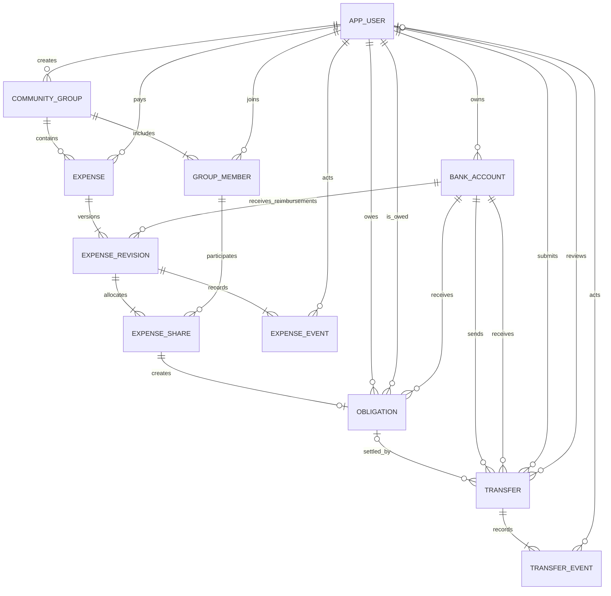

# MiniBank – podatkovni model

## Pristop in meje modela

MVP uporablja relacijsko bazo **PostgreSQL** in **11 povezanih entitet**. Spodnji model pokriva F01–F07 ter administracijo dostopov. Razširitve za F08–F15 so navedene ločeno in še niso del MVP.

Primarni ključi so UUID. Časi so `timestamptz` (API: ISO 8601), datum stroška je `date`. Denarni podatki so `numeric(15,2)` oziroma C# `decimal`; API jih pošilja kot decimalne nize, na primer `"30.00"`. Izračun delitve uporablja cele cente. `PK` označuje primarni ključ, `FK` tuji ključ, `UQ` enoličnost, `?` pa dovoljeno prazno vrednost. Ostala polja so obvezna. Statusi in vloge imajo omejene nabore vrednosti CHECK.

## 1. Uporabnik (`app_user`)

| Polje | Tip in namen |
| --- | --- |
| `id` | UUID, PK. |
| `email` | varchar(254), UQ, normaliziran v male črke; prijavno ime. |
| `password_hash` | varchar(255); zgoščeno geslo. |
| `full_name` | varchar(120); ime za prikaz. |
| `role` | varchar(20): `CUSTOMER`, `CLERK`, `ADMIN`. |
| `active` | boolean; preveri se pri vsaki zahtevi. |
| `created_at` | timestamptz. |

Uporabnikov fizično ne brišemo. Deaktivacija ohrani račune, članstva, odločitve in obveznosti. Račune in članstva imajo samo komitenti; to preveri storitvena plast. Sprememba vloge komitenta z računom ali članstvom ni dovoljena.

## 2. Bančni račun (`bank_account`)

| Polje | Tip in namen |
| --- | --- |
| `id` | UUID, PK. |
| `owner_id` | UUID, FK → `app_user.id`. |
| `account_number` | varchar(20), UQ; interna oznaka, npr. `MB-000001`. |
| `currency` | char(3), CHECK = `EUR`. |
| `opening_balance` | numeric(15,2), ≥ 0; nespremenljiv začetni znesek iz razvojnih podatkov. |
| `balance` | numeric(15,2), ≥ 0; spreminja ga samo izvedba nakazila. |
| `created_at` | timestamptz. |

Komitent ima lahko več računov; vsak račun ima enega lastnika. Skupina nima računa. Začetni računi in sredstva se ustvarijo z razvojnim inicializatorjem, ne prek administrativnega vmesnika.

## 3. Nakazilo (`transfer`)

| Polje | Tip in namen |
| --- | --- |
| `id` | UUID, PK; referenca nakazila. |
| `source_account_id` | UUID, FK → `bank_account.id`. |
| `target_account_id` | UUID, FK → `bank_account.id`; različen od izvornega. |
| `created_by` | UUID, FK → `app_user.id`; lastnik izvornega računa. |
| `obligation_id` | UUID?, FK → `obligation.id`; prazno za navadno nakazilo. |
| `amount` | numeric(15,2), > 0. |
| `purpose` | varchar(140), neprazno; pri poravnavi sistemski namen z referenco obveznosti. |
| `status` | varchar(24): `PENDING_APPROVAL`, `EXECUTED`, `REJECTED`, `FAILED`. |
| `idempotency_key` | UUID; UQ skupaj z `created_by`. |
| `created_at` | timestamptz. |
| `executed_at` | timestamptz?; prisoten natanko pri `EXECUTED`. |
| `reviewed_by` | UUID?, FK → `app_user.id`; uslužbenec. |
| `reviewed_at` | timestamptz?; prisoten skupaj z `reviewed_by`. |
| `rejection_reason` | varchar(500)?; neprazen natanko pri `REJECTED`. |
| `failure_code` | varchar(40)?; natanko pri `FAILED`, npr. `INSUFFICIENT_FUNDS`, `USER_INACTIVE`, `BALANCE_LIMIT_EXCEEDED`. |

Podatki oddane zahteve (računa, znesek, namen, avtor, povezava z obveznostjo) so nespremenljivi. Enak ključ in vsebina vrneta obstoječe nakazilo, spremenjena vsebina pa konflikt. Neposredno nakazilo ima samo uspešen shranjen izid; vhodna napaka se vrne brez nakazila. Zato sta pri `FAILED` in `REJECTED` uslužbenec in čas obravnave obvezna, pri neposredni izvedbi pa prazna.

Za povezano poravnavo storitev preveri: avtor = dolžnik obveznosti, cilj = račun upnika obveznosti, znesek = celotni znesek obveznosti. Delni enolični indeks na `obligation_id`, kjer je ta neprazen in je status `PENDING_APPROVAL` ali `EXECUTED`, zagotavlja največ en čakajoči ali uspešni poskus na obveznost v MVP. Zavrnjeni in neuspešni poskusi ostanejo v zgodovini ter dopuščajo nov poskus. Za F09 bo treba to omejitev namensko spremeniti.

## 4. Dogodek nakazila (`transfer_event`)

| Polje | Tip in namen |
| --- | --- |
| `id` | UUID, PK. |
| `transfer_id` | UUID, FK → `transfer.id`. |
| `sequence_no` | integer, > 0; UQ skupaj s `transfer_id`. |
| `event_type` | varchar(24): `SUBMITTED`, `APPROVED`, `REJECTED`, `EXECUTED`, `FAILED`. |
| `actor_id` | UUID?, FK → `app_user.id`; prazno pri sistemskem dogodku. |
| `created_at` | timestamptz. |
| `detail` | varchar(500)?; razlog zavrnitve ali poslovne napake. |

Dogodki se samo dodajajo. Oddaja in dogodki se shranijo v isti transakciji. Neposredna izvedba ustvari `SUBMITTED`, `EXECUTED`; uspešna odobritev doda `APPROVED`, `EXECUTED`; poslovno neuspešna odobritev doda `APPROVED`, `FAILED`.

## 5. Skupina (`community_group`)

| Polje | Tip in namen |
| --- | --- |
| `id` | UUID, PK. |
| `name` | varchar(100), neprazno. |
| `description` | varchar(500)?. |
| `created_by` | UUID, FK → `app_user.id`; ustvarjalec. |
| `created_at` | timestamptz. |

MVP vsebuje samo aktivne skupine; arhiviranje in izstop sta F14. Ustvarjanje skupine in aktivnega članstva njenega organizatorja je ena transakcija. Trenutni organizator se določi iz članstva, `created_by` pa ostane zgodovinski podatek.

## 6. Članstvo in povabilo (`group_member`)

| Polje | Tip in namen |
| --- | --- |
| `id` | UUID, PK. |
| `group_id` | UUID, FK → `community_group.id`. |
| `user_id` | UUID, FK → `app_user.id`; UQ skupaj z `group_id`. |
| `role` | varchar(16): `ORGANIZER`, `MEMBER`. |
| `status` | varchar(16): `INVITED`, `ACTIVE`, `DECLINED`. |
| `invited_by` | UUID, FK → `app_user.id`; pri ustvarjalcu njegova lastna oznaka. |
| `invited_at` | timestamptz. |
| `responded_at` | timestamptz?; prazno pri `INVITED`. |
| `joined_at` | timestamptz?; prisotno samo pri `ACTIVE`. |

Povabilo in članstvo sta isti zapis. `INVITED` preide v `ACTIVE` ali `DECLINED` samo po odločitvi povabljenega. Ponovno povabilo zavrnjenemu članu posodobi isti zapis na `INVITED` in ponastavi čase odgovora. Podvojeno povabilo aktivnemu ali že povabljenemu uporabniku vrne konflikt. Organizator mora biti `ACTIVE`. Delni UQ indeks zagotovi največ enega aktivnega organizatorja na skupino; storitev ob ustvarjanju zagotovi, da obstaja natanko eden.

## 7. Strošek (`expense`)

| Polje | Tip in namen |
| --- | --- |
| `id` | UUID, PK; stalna referenca skozi različice. |
| `group_id` | UUID, FK → `community_group.id`. |
| `payer_id` | UUID, FK → `app_user.id`; avtor in dejanski plačnik. |
| `created_at` | timestamptz. |

Plačnik mora biti aktiven komitent in aktiven član skupine. Najnovejša različica je zapis z največjim `revision_no`; ta številka se dodeli pod zaklepom stroška. Ločeno podvajanje oznake trenutne različice v tabeli `expense` ni potrebno.

## 8. Različica stroška (`expense_revision`)

| Polje | Tip in namen |
| --- | --- |
| `id` | UUID, PK. |
| `expense_id` | UUID, FK → `expense.id`. |
| `revision_no` | integer, > 0; UQ skupaj z `expense_id`. |
| `row_version` | integer, > 0; števec za optimistično zaščito urejanja osnutka. |
| `title` | varchar(140), neprazno. |
| `expense_date` | date; datum že plačanega stroška, ne prihodnji datum ob oddaji. |
| `category` | varchar(20): `FOOD`, `TRANSPORT`, `ACCOMMODATION`, `HOUSEHOLD`, `OTHER`. |
| `total_amount` | numeric(15,2), > 0. |
| `split_method` | varchar(12): `EQUAL`, `EXACT`. |
| `reimbursement_account_id` | UUID, FK → `bank_account.id`; račun plačnika za povračila. |
| `status` | varchar(24): `DRAFT`, `PENDING_CONFIRMATION`, `DISPUTED`, `CONFIRMED`, `SUPERSEDED`, `CANCELLED`. |
| `created_at` | timestamptz. |
| `submitted_at` | timestamptz?; čas oddaje predloga. |
| `confirmed_at` | timestamptz?; prisoten natanko pri `CONFIRMED`. |

V MVP se osnutek shrani šele z izpolnjenimi obveznimi polji. Po oddaji se vsebina različice ne spreminja; spreminjajo se le stanje in odločitve. Novo različico se ustvari samo iz `DISPUTED`; stara dobi `SUPERSEDED`. Potrjene ali preklicane različice ni mogoče nadomestiti. Prehodi so določeni v dokumentu 02. Delni UQ indeks na `expense_id` pri `status = CONFIRMED` dodatno prepreči dve potrjeni različici istega stroška.

## 9. Delež in odločitev (`expense_share`)

| Polje | Tip in namen |
| --- | --- |
| `id` | UUID, PK. |
| `revision_id` | UUID, FK → `expense_revision.id`. |
| `member_id` | UUID, FK → `group_member.id`; UQ skupaj z `revision_id`. |
| `amount` | numeric(15,2), ≥ 0. |
| `decision` | varchar(12): `PENDING`, `ACCEPTED`, `DISPUTED`. |
| `decided_at` | timestamptz?; prazno natanko pri `PENDING`. |
| `dispute_reason` | varchar(500)?; neprazno natanko pri `DISPUTED`. |

Storitev ob oddaji preveri, da vsa članstva pripadajo skupini stroška, da so člani aktivni in da vsota deležev ustreza celotnemu znesku. Vključen je plačnik in vsaj en drug član s pozitivnim deležem. Ti pogoji vključujejo več vrstic, zato jih navadni CHECK ne zagotavlja. Izračun in zapis potekata pod istim zaklepom stroška. Ob oddaji plačnikov delež postane `ACCEPTED`, drugi ostanejo `PENDING`. Po odločitvi svojega odgovora ni mogoče prepisati; enaka ponovitev je varna, nasprotna odločitev vrne konflikt.

## 10. Potrjena obveznost (`obligation`)

| Polje | Tip in namen |
| --- | --- |
| `id` | UUID, PK. |
| `share_id` | UUID, FK → `expense_share.id`, UQ. |
| `debtor_id` | UUID, FK → `app_user.id`; uporabnik iz deleža. |
| `creditor_id` | UUID, FK → `app_user.id`; plačnik stroška; različen od dolžnika. |
| `target_account_id` | UUID, FK → `bank_account.id`; račun za povračila iz potrjene različice. |
| `amount` | numeric(15,2), > 0; potrjeni delež. |
| `created_at` | timestamptz. |

Obveznosti nastanejo izključno ob zadnji potrditvi, skupaj s statusom `CONFIRMED` in dogodkom, v isti transakciji. Za lastni delež plačnika in ničelne deleže jih ni. Avtoritativni finančni podatki obveznosti so po ustvarjanju nespremenljivi; storitev preveri ujemanje z izvorno različico.

Stanje obveznosti je **izračunano**, ne ločeno shranjeno: `SETTLED`, če obstaja `EXECUTED`; sicer `PAYMENT_PENDING`, če obstaja `PENDING_APPROVAL`; sicer `OPEN`. Odprti znesek je v MVP celotni `amount` ali nič. S tem ne nastajata dve neodvisni resnici o poravnavi. Pregled skupine uporablja namenski DTO s povzetkom, ne bančnega DTO nakazila.

## 11. Dogodek stroška (`expense_event`)

| Polje | Tip in namen |
| --- | --- |
| `id` | UUID, PK. |
| `revision_id` | UUID, FK → `expense_revision.id`. |
| `sequence_no` | integer, > 0; UQ skupaj z `revision_id`. |
| `event_type` | varchar(24): `CREATED`, `SUBMITTED`, `SHARE_ACCEPTED`, `DISPUTED`, `SUPERSEDED`, `CONFIRMED`, `CANCELLED`. |
| `actor_id` | UUID, FK → `app_user.id`. |
| `created_at` | timestamptz. |
| `detail` | varchar(500)?; obrazložitev ugovora ali referenca nove različice. |

Dogodki se dodajajo v isti transakciji kot odločitev ali prehod. Ohranjeni deleži in odločitve prejšnjih različic omogočajo pregled usklajevanja. Osnutkov ne beležimo ob vsakem pritisku tipke; sledimo oddajam in poslovnim odločitvam.

## Povezave in osnutek modela

Diagram prikazuje glavne povezave; `invited_by` je dodatni FK na uporabnika iz tabele članstva. Obveznost ima lahko več poskusov nakazila, vendar v MVP največ enega čakajočega ali izvedenega. Navadno nakazilo nima obveznosti. Najmanj eno različico, deleže in začetne dogodke ob ustvarjanju zagotavljajo storitve v transakciji.

## Celovitost, sočasnost in indeksi

Prenos spremeni obe stanji, status in dogodke atomarno; izračunano stanje obveznosti zato takoj odraža isti rezultat. Vnos stroška ali soglasje nikoli ne spremeni bančnega stanja.

Vse spreminjajoče skupinske operacije najprej zaklenejo vrstico skupine. Enotni vrstni red nadaljnjih zaklepov je: **skupina → strošek → obveznost → nakazilo → uporabniki po ID → računi po ID**; neuporabljene vrste se preskočijo. Odločanje o povezani poravnavi najprej iz nespremenljivih povezav ugotovi skupino in obveznost, nato pridobi zaklepe v tem vrstnem redu ter ponovno preveri vse pogoje. Navadno nakazilo preskoči skupinske vrste. Deaktivacija zaklepa uporabnika, ne posega nato nazaj v skupino.

Za MVP je namerno izbrana serializacija sprememb znotraj iste skupine, ker poenostavi soglasja in preprečevanje dvojnih poravnav. PostgreSQL vrstični zaklepi `SELECT ... FOR UPDATE` in enolični indeksi dopolnjujejo preverjanje v storitvah. Ob morebitni medsebojni blokadi se transakcija razveljavi in varno ponovi; ponovitev nakazila ohrani ključ zahteve. Stara različica predloga in zastarela `row_version` pri urejanju vrneta konflikt.

Pomembne invariance:

- vsota deležev oddane različice = celotni znesek stroška;
- obveznosti obstajajo samo za potrjeno različico in tuje pozitivne deleže;
- vsota stanj računov je pri internih nakazilih nespremenjena;
- stanje računa = začetno stanje + izvedeni prilivi − izvedeni odlivi;
- vsota neto položajev članov skupine je nič;
- čakajoči, neuspešni in zavrnjeni poskusi ne zmanjšajo odprtega dolga;
- tehnična napaka ne sme pustiti samo bremenitve, samo potrditve ali delno ustvarjenih obveznosti.

FK uporabljajo `ON DELETE RESTRICT`. Poleg navedenih UQ indeksov so predvideni indeksi na `bank_account(owner_id)`, `group_member(user_id, status)`, `expense(group_id, created_at)`, `expense_revision(expense_id, revision_no)`, `expense_share(member_id, decision)`, `obligation(debtor_id)`, `obligation(creditor_id)`, `transfer(obligation_id)`, `transfer(status, created_at)` ter parih `(source_account_id, created_at)` in `(target_account_id, created_at)`.

## Predvidene razširitve modela po MVP

| Funkcionalnost | Potrebna razširitev |
| --- | --- |
| F08 – poenostavitev | `settlement_plan`, soglasja, različica vhodnega nabora in povezave med nadomeščenimi ter novimi obveznostmi. Nadomeščanje ne sme biti označeno kot bančno plačilo. Nov upnik izbere svoj prejemni račun ob soglasju. |
| F09 – delne poravnave | Več izvedenih nakazil na obveznost, izračun preostanka, UQ samo za čakajoči poskus in transakcijska kontrola vsote. |
| F10 – ponavljanja | Predloga, udeleženci, deleži in UQ `(template_id, period)` na ustvarjenih osnutkih. |
| F11 – proračuni | Skupinski proračun z obdobjem, limitom in kategorijami. |
| F12 – cilji | Informativni cilj in prispevki članov; brez povezave na spremembo bančnega stanja. |
| F13 – obvestila | Potrjeni `due_date` na različici, izpeljan rok obveznosti, trajna obvestila z enoličnim ključem dogodka in časom branja. |
| F14 – zaključevanje | Status skupine, `closed_at`, stanje članstva `LEFT`, `left_at` ter sled prenosa organizacije. |
| F15 – izvoz | Poizvedba nad obstoječimi podatki s presečnim časom; po uvedbi F08 upošteva tudi zgodovino nadomestitev. |

Podrobna shema nadgradenj se pripravi pred njihovo implementacijo. [Funkcionalnosti](02-funkcionalnosti-in-obseg.md) in [zgodbe](05-uporabniske-zgodbe.md) določajo pričakovano vedenje, ne trditve o že izvedeni aplikaciji.
