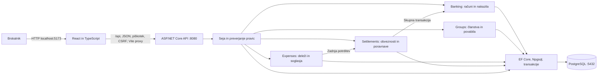

# MiniBank – arhitektura in tehnološki sklad

## Glavni deli sistema

MiniBank bo **modularni monolit** z enim backendom, enim spletnim odjemalcem in eno relacijsko bazo. Poslovni moduli so ločeni v kodi, vendar sodelujejo v isti podatkovni transakciji. Dokument je načrt implementacije; repozitorij trenutno vsebuje dokumentacijo in žične modele, ne delujoče aplikacije.

1. **Frontend:** React in TypeScript za račune, skupine, stroške, potrjevanje deležev, obveznosti, poravnave ter ločena pogleda uslužbenca in administratorja.
2. **REST API:** ASP.NET Core; vhodni DTO, validacija, seja, CSRF in preverjanje sistemske vloge ter pravice na konkretnem viru. Entitet baze se ne vrača neposredno.
3. **Storitvena plast:** moduli Identity, Banking, Groups, Expenses in Settlements; poslovna pravila, prehodi stanj, idempotentnost ter transakcijske meje.
4. **Podatkovna plast:** EF Core z Npgsql in PostgreSQL. Običajne poizvedbe uporablja EF Core; kritični postopki uporabljajo eksplicitne transakcije in parametrizirane vrstične zaklepe.



Puščice med moduli pomenijo klice storitev znotraj istega procesa. Ni mikroservisov ali medsebojnih omrežnih klicev. MVP ne potrebuje vrste sporočil, periodičnega delavca ali komunikacije WebSocket. Pogled se osveži po dejanju in ob ponovnem odprtju; pri prikazanem čakajočem nakazilu frontend preveri status vsakih 10 sekund, dokler je zaslon aktiven.

## Odgovornosti in transakcijske meje

| Modul | Odgovornost | Kritična meja |
| --- | --- | --- |
| Identity | Prijava, strežniška seja, uporabniki, vloge in aktivnost. | Deaktivacija se uskladi s preverjanjem uporabnika pri plačilu. |
| Banking | Računi, splošna nakazila, prag 500 EUR, uslužbenčeve odločitve in dogodki. | Bremenitev, dobroimetje, status in dogodki uspejo skupaj. |
| Groups | Skupine, organizator, povabila in dostop članov. | Skupina in organizator nastaneta skupaj. |
| Expenses | Osnutki, razdelitev centov, različice in odločitve udeležencev. | Zadnja potrditev, potrjena različica in vse obveznosti nastanejo skupaj. |
| Settlements | Pregled obveznosti, neto položaji, varna poravnava. | Ustvarjanje povezanega nakazila in bančna izvedba uporabljata isto transakcijo. |

Skupno transakcijo vodi aplikacijska storitev; modul Banking med poravnavo ne sme samostojno potrditi notranje transakcije. Poslovnih rezultatov ne usklajujemo naknadno z asinhronimi dogodki. Zgodovinski dogodki so del iste baze in iste potrditve.

## Komunikacija in osnutek API

Frontend uporablja `/api`, HTTP in JSON. Vite posreduje zahteve backendu, zato brskalnik uporablja isti izvor. Zneski so decimalni nizi, datumi stroškov `YYYY-MM-DD`, časi ISO 8601. Backend pridobi uporabnika iz seje, nikoli iz zaupanja v poslani `userId`. Vsi spreminjajoči klici zahtevajo CSRF.

### Prijava, banka in administracija

| Metoda in pot | Namen in dostop |
| --- | --- |
| `GET /api/auth/csrf` | Žeton tudi pred prijavo. |
| `POST /api/auth/login` | Prijava in ustvarjanje seje. |
| `POST /api/auth/logout` | Odstranitev strežniške seje in piškotka. |
| `GET /api/auth/me` | Trenutni uporabnik in sistemska vloga. |
| `GET /api/accounts` | Lastni računi komitenta. |
| `GET /api/accounts/{id}/transactions` | Zadnjih 20 izvedenih nakazil lastnega računa. |
| `GET /api/transfers` | Lastna oddana ter prejeta izvedena nakazila, 20 na stran. |
| `POST /api/transfers` | Navadno nakazilo; `Idempotency-Key`. Ne sprejema povezave na obveznost. |
| `GET /api/transfers/{id}` | Podrobnosti in dogodki glede na bančne pravice. |
| `GET /api/review/transfers` | Čakalna vrsta od najstarejšega ali lastna obravnavana nakazila uslužbenca, 20 na stran. |
| `POST /api/transfers/{id}/decision` | `APPROVE` ali `REJECT`; pri zavrnitvi obvezen razlog. |
| `GET /api/admin/users` | Uporabniki brez gesel in finančnih podatkov. |
| `POST /api/admin/users` | Ustvarjanje dostopa z začetnim geslom. |
| `PATCH /api/admin/users/{id}` | Aktivnost ali vloga ob preverjanju omejitev. |

### Skupine, stroški in poravnave

| Metoda in pot | Namen in dostop |
| --- | --- |
| `GET /api/groups` | Skupine, v katerih je komitent aktiven član. |
| `POST /api/groups` | Ustvarjanje skupine in organizatorskega članstva. |
| `GET /api/invitations` | Povabila trenutnemu komitentu z omejenimi podatki. |
| `POST /api/groups/{id}/invitations` | Povabilo po e-pošti; organizator. |
| `POST /api/invitations/{id}/response` | `ACCEPT` ali `DECLINE`; samo povabljeni. |
| `GET /api/groups/{id}` | Podrobnosti, člani in povzetek; aktivni član. |
| `GET /api/groups/{id}/expenses` | Stroški po datumu, filtri stanja, 20 na stran. Osnutek vidi samo njegov avtor. |
| `POST /api/groups/{id}/expenses/preview` | Izračun delitve brez shranjevanja; backend določi ostanek centov. |
| `POST /api/groups/{id}/expenses` | Shranitev popolnega osnutka s prvo različico; plačnik je trenutni uporabnik. |
| `GET /api/expenses/{id}` | Predlog, deleži, odločitve in zgodovina; aktivni član, osnutek samo avtor. |
| `PATCH /api/expenses/{id}/revisions/{number}` | Urejanje trenutnega osnutka; avtor, z `If-Match` za `row_version`. |
| `POST /api/expenses/{id}/revisions/{number}/submit` | Oddaja osnutka; avtor, `If-Match`; zamrzne vsebino in potrdi njegov delež. |
| `POST /api/expenses/{id}/revisions/{number}/decision` | `ACCEPT` ali `DISPUTE` z razlogom; samo vključeni član za svoj delež. |
| `POST /api/expenses/{id}/revisions` | Nova različica iz trenutne sporne; avtor, pričakovana številka izvorne različice. |
| `POST /api/expenses/{id}/revisions/{number}/cancel` | Preklic nepotrjene trenutne različice; avtor. |
| `GET /api/groups/{id}/obligations` | Obveznosti, povzetki poravnav in neto položaji; aktivni član, 20 vrstic na stran. |
| `GET /api/obligations` | Lastne obveznosti in terjatve čez skupine, 20 na stran. |
| `POST /api/obligations/{id}/settlements` | Poravnava odprte obveznosti; samo dolžnik, `Idempotency-Key`. |

Za ustvarjanje skupin, povabil in osnutkov MVP ne predvideva samodejnega omrežnega ponavljanja POST; uporabnik po nejasnem izidu najprej osveži seznam. Bančna idempotentnost je obvezna. Ponovljena enaka odločitev člana o isti različici vrne trenutno stanje brez novega dogodka; nasprotna odločitev ali zastarela različica vrne konflikt.

Primer delitve (telo osnutka ali predogleda):

```json
{
  "title": "Večerja",
  "expenseDate": "2026-10-17",
  "category": "FOOD",
  "totalAmount": "90.00",
  "reimbursementAccountId": "11111111-1111-4111-8111-111111111111",
  "splitMethod": "EQUAL",
  "participants": [
    { "memberId": "22222222-2222-4222-8222-222222222222" },
    { "memberId": "33333333-3333-4333-8333-333333333333" },
    { "memberId": "44444444-4444-4444-8444-444444444444" }
  ]
}
```

Pri `EXACT` ima vsak udeleženec še `amount`, npr. `"30.00"`. Backend vedno ponovno preveri oziroma izračuna deleže; predogled na frontendu ni avtoritativna potrditev.

Primer telesa zahteve za poravnavo:

```json
{
  "sourceAccountId": "55555555-5555-4555-8555-555555555555"
}
```

Obveznost je določena v poti. Cilj, znesek in namen določi backend iz potrjene obveznosti. Polja za prepis zneska ali prejemnika se zavrnejo. Prva uspešna oddaja vrne `201` z nakazilom in povzetkom obveznosti, ponovitev istega ključa in vsebine `200`. Primerjava ključa vključuje uporabnika, vrsto operacije, obveznost in izvorni račun; isti ključ z drugo vsebino vrne `409`. Pri ponovitvi se vrne obstoječi rezultat pred zavrnitvijo zaradi že poravnane obveznosti.

### Napake in zasebnost odgovorov

Napake imajo obliko `{ "code": "...", "message": "...", "fieldErrors": [] }`:

- `400`: neveljaven vnos, napačna vsota deležev, manjkajoč razlog, nezadostna sredstva pri oddaji ali neveljaven CSRF;
- `401`: manjkajoča, pretečena ali preklicana seja;
- `403`: sistemska vloga ne dovoljuje operacije;
- `404`: vir ne obstaja ali uporabnik nima dostopa do konkretnega vira;
- `409`: napačno stanje, dvojna poravnava, zastarela različica, neskladna vsebina istega ključa ali prepovedana sprememba vloge;
- `412`: zastarel `If-Match` pri urejanju ali oddaji osnutka;
- `5xx`: tehnična napaka z razveljavitvijo transakcije.

Poslovno neuspešna izvedba po odobritvi vrne `200` in `FAILED`; to ni tehnična napaka API. Skupinski odgovor iz nakazila razkrije samo stanje poravnave, znesek in čas uspeha. Razlog neuspeha ter izvorni račun vidi samo upravičen bančni pogled. Namen sistemske poravnave vsebuje referenco obveznosti, ne zasebnega opisa večerje, zato uslužbenčeva obravnava ne razkriva vsebine skupine.

## Avtentikacija in upravljanje uporabnikov

- Uporabniki so v `app_user`. Gesla obdeluje `PasswordHasher<AppUser>` iz ASP.NET Core Identity; čista gesla se ne shranjujejo in ne beležijo.
- Uporabi se Cookie Authentication (`AddAuthentication().AddCookie()`). Piškotek `MiniBank.Auth` ima `HttpOnly`, `SameSite=Lax`, pri HTTPS tudi `Secure`. Lokalni HTTP je dovoljen samo v `Development`.
- Izrecno se nastavi `CookieAuthenticationOptions.SessionStore` z implementacijo `ITicketStore` v pomnilniku. Piškotek vsebuje zaščiteno referenco, vstopnica ostane na strežniku. Po ponovnem zagonu je potrebna prijava, poslovni podatki pa ostanejo v bazi.
- Shramba sej beleži zadnjo aktivnost in po 30 minutah neaktivnosti odstrani vstopnico. Prijava ustvari novo referenco; odjava prek `SignOutAsync` odstrani vstopnico in piškotek. Pretečeni vnosi se sproti čistijo.
- Vse spreminjajoče metode, tudi prijava in odjava, preverijo `IAntiforgery` žeton v glavi `X-CSRF-TOKEN`. Frontend ga pridobi pred prijavo in ponovno po prijavi ali odjavi.
- `OnValidatePrincipal` pri vsaki zahtevi preveri aktivnost in trenutno sistemsko vlogo v bazi. Sprememba dostopa učinkuje tudi na odprte seje. Članstva se preverjajo iz baze ob dostopu do konkretne skupine; niso trajno zapisana kot pravice v piškotku.
- Administrator ustvarja dostope. Začetna gesla demonstracijskih uporabnikov se določijo lokalno in niso vključena v repozitorij. Novi dostop sam ne ustvari računa ali denarja.

## Tehnološki sklad

| Del | Izbira | Utemeljitev |
| --- | --- | --- |
| Frontend | React, TypeScript, Vite, HTML, CSS | Komponente za skupine in finančne poglede; tipizirane pogodbe API. |
| Backend | C#, .NET 10, ASP.NET Core Web API, Data Annotations | REST API, preverjanje pravic in poslovna pravila. |
| Podatkovna plast | Entity Framework Core 10, Npgsql | Relacijska preslikava, migracije in eksplicitne transakcije. |
| Baza | PostgreSQL 17 | Povezane entitete, decimalni zneski, omejitve in vrstični zaklepi. |
| Avtentikacija | Cookie Authentication, `ITicketStore`, `PasswordHasher<AppUser>` | Strežniške seje in upravljanje dostopov. |
| Lokalni razvoj | Node.js 22, npm, .NET SDK 10, Docker Compose, Git | Ločen zagon aplikacije in baze, sledljiv razvoj. |
| Preverjanje | xUnit, WebApplicationFactory, Testcontainers for .NET s PostgreSQL, Vitest | Poslovna pravila, integracija, sočasnost in ključni prikazi vmesnika. |
| Žični modeli | PNG in lokalna skripta Python/Pillow | Ponovljivo generirane sheme zaslonov v dokumentaciji; niso odvisnost aplikacije. |

Različice ohranjajo načrtovano osnovo prvotne zasnove in niso trditev o najnovejših izdajah. Pred implementacijo se preveri medsebojna združljivost in zaklene točne različice v `.csproj`, `global.json`, `packages.lock.json` ter `package-lock.json`. Za Npgsql se izbere izdaja, združljiva z EF Core 10.

## Načrt lokalnega zagona

Predvidena struktura aplikacije:

```text
docs/
  wireframes/
  tools/generate_wireframes.py
frontend/
backend/MiniBank.Api/
backend/MiniBank.Tests/
.config/dotnet-tools.json
global.json
compose.yaml
.env.example
.gitignore
```

Spodnji ukazi določajo pričakovani način zagona po implementaciji; datoteke aplikacije in zagonske nastavitve še niso ustvarjene. Delovni imenik je koren projekta `MiniBank`.

1. Namestiti načrtovani Node.js, .NET SDK in Docker z zagnanim pogonom. Iz `.env.example` pripraviti lokalni `.env` s podatki za bazo. Gesla in `.env` se izključijo iz Git.
2. Bazo zagnati z `docker compose up -d db`. Storitev `db` uporablja PostgreSQL 17, vrata 5432 in trajni nosilec `minibank_data`; povezava aplikacije in Compose uporabljata iste lokalne nastavitve.
3. Backend konfigurirati prek .NET user-secrets: `ConnectionStrings:MiniBank`, razvojna gesla in `Seed:Enabled=true`. ASP.NET Core datoteke `.env` ne bere samodejno; povezavo mu izrecno poda konfiguracija. Inicializator deluje samo v `Development` in ne ponastavlja že obstoječih stanj.
4. V korenu izvesti `dotnet tool restore`, `dotnet restore` in `dotnet ef database update --project backend/MiniBank.Api`. Migracije pripravijo shemo in omejitve.
5. Backend zagnati z `dotnet run --project backend/MiniBank.Api --launch-profile Development`. Profil določa `http://localhost:8080` in razvojno okolje.
6. V mapi `frontend` izvesti `npm ci` in `npm run dev -- --host localhost --port 5173`. Vite posreduje `/api` na `http://localhost:8080`.
7. Odpreti `http://localhost:5173` in uporabiti lokalne demonstracijske dostope. Za demonstracijo so pripravljeni Ana, Bor, Cene, uslužbenec in administrator; komitenti imajo začetne račune. Skripta pripravi tudi primere skupinskih stanj.
8. Ustavitev aplikacij ne izbriše baze. `docker compose stop` ohrani podatkovni nosilec; ponovni zagon backenda zahteva novo prijavo.

## Pomembne arhitekturne odločitve

| Odločitev | Razlog in posledica |
| --- | --- |
| [Modularni monolit](adr/0001-modularni-monolit.md) | Skupni transakciji za nakazila in dolgove ne zahtevata porazdeljenega usklajevanja; moduli omogočajo nadaljnji razvoj. |
| [Ena relacijska baza](adr/0002-ena-relacijska-baza.md) | Članstva, soglasja, dolgovi in nakazila so povezani s FK in omejitvami. |
| [Ločitev stroška od denarja](adr/0003-locitev-stroska-od-denarja.md) | Evidenca zunanjega plačila ne sme ustvariti dodatne bremenitve računa. |
| [Nespremenljiv oddani predlog](adr/0004-nespremenljivi-predlogi.md) | Član potrdi točno določen znesek in udeležence; popravek zahteva novo soglasje. |
| [Izračunano stanje obveznosti](adr/0005-izracunano-stanje-obveznosti.md) | Izvedeno povezano nakazilo je vir resnice o poravnavi; ni ročnega označevanja »plačano«. |
| [Račun prejemnika določen v predlogu](adr/0006-racun-prejemnika-v-predlogu.md) | Dolžnik pri poravnavi ne more zamenjati upnika ali zneska. |
| [Centi in decimalni tipi](adr/0007-centi-in-decimalni-tipi.md) | Delitev ne izgublja centov in ne uporablja binarne plavajoče vejice. |
| [Zaklep skupine in enoten vrstni red](adr/0008-zaklepi-in-vrstni-red.md) | MVP daje prednost preprostemu zagotavljanju pravilnosti; zaklepi računov ščitijo tudi nakazila med skupinami. |
| [Idempotentnost in omejitev aktivne poravnave](adr/0009-idempotentnost-in-aktivna-poravnava.md) | Isti ključ ščiti omrežne ponovitve; dodatna omejitev obveznosti ščiti pred dvema različnima zahtevama. |
| [Prag 500 EUR brez rezervacije](adr/0010-odobritveni-prag-brez-rezervacije.md) | Ohranja obstoječi odobritveni proces in zahteva ponovno preverjanje sredstev ob izvedbi. |
| [Pravice glede na vlogo in vir](adr/0011-pravice-glede-na-vlogo-in-vir.md) | Organizator ni skrbnik denarja drugih; članstvo ne omogoča dostopa do bančnih podrobnosti. |
| [Omejen MVP](adr/0012-omejen-mvp.md) | Ni delnih poravnav, avtomatskega pobota ali skupnega računa. Te spremembe zahtevajo nove poslovne odločitve in migracije. |

## Načrt preverjanja

- **Enotski testi:** enakomerna delitev in ostanek centov, ročna vsota, ničelni delež plačnika, prehodi različic, izračun neto položajev in pravila dostopa.
- **Integracijski testi z dejansko bazo:** sočasni zadnji potrditvi ustvarita en nabor obveznosti; napaka med ustvarjanjem dolgov razveljavi tudi potrditev; napaka med bremenitvijo in dobroimetjem razveljavi celoten prenos; dve zahtevi z različnima ključema ne poravnata istega dolga dvakrat; dve odobritvi in sočasna poraba ne povzročijo dvojnega prenosa ali negativnega stanja.
- **API:** meje 500/500,01 EUR, ponovitev idempotentne zahteve, zastarel predlog, `If-Match`, ugovor brez razloga, deaktivacija med čakanjem ter prepoved vpogleda nečlanu in v osebne podatke drugih.
- **Uporabniški vmesnik:** celoten primer večerje, ugovor in nova različica, poravnava z nezadostnimi sredstvi, čakajoča in neuspešna odobritev, prazni seznami ter dostop vseh treh vlog. Preveriti tudi tipkovnico, vidne oznake polj in besedilne statuse.
- **Trajnost:** ponovni zagon aplikacije in baze z istim nosilcem ohrani poslovne podatke; strežniške seje se obnovijo z novo prijavo.

To je načrt testiranja prihodnje aplikacije. Pogoji sprejema so v [uporabniških zgodbah](05-uporabniske-zgodbe.md), predvideni zasloni pa v [žičnih modelih](06-wireframes.md).
