# MiniBank – žični modeli

Žični modeli prikazujejo predvidene zaslone aplikacije. WF-01–WF-11 sodijo v MVP, WF-12 pa je kasnejša nadgradnja. Slike ponazarjajo različne primere uporabe in niso posnetki delujoče aplikacije.

[Pregled vseh zaslonov](wireframes/WF-00-pregled.png) · [Uporabniške zgodbe](05-uporabniske-zgodbe.md)

## WF-01 – Prijava

Povezana zgodba: US-18.

Uporabnik vnese e-pošto in geslo. Po uspešni prijavi se odpre zaslon njegove vloge, ob napaki pa se prikaže sporočilo »Prijava ni uspela«.

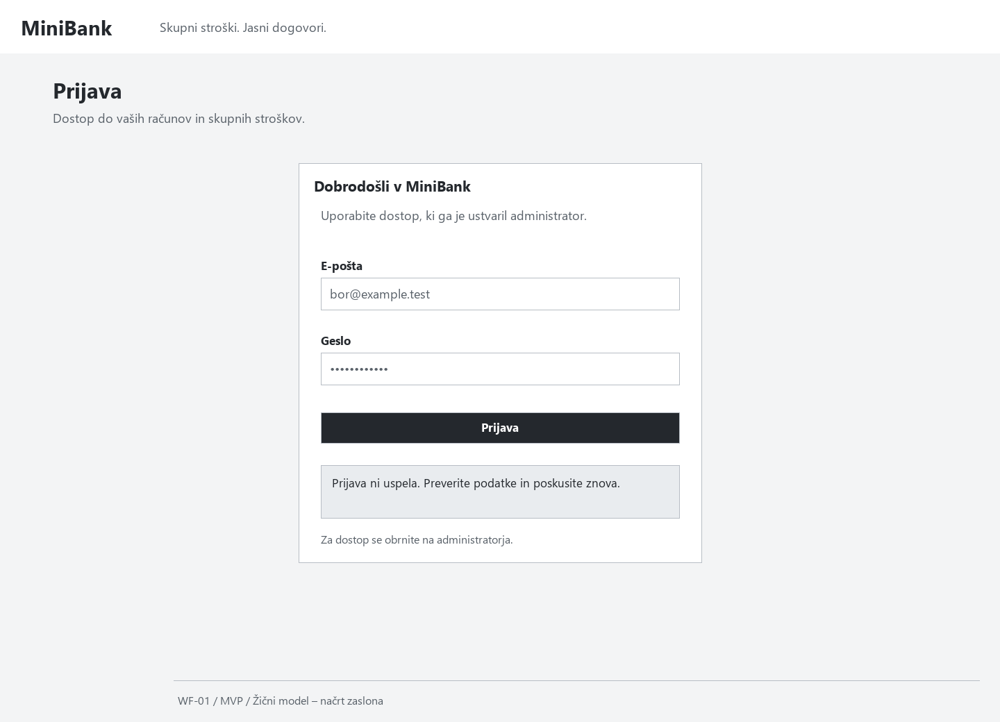

## WF-02 – Finančni pregled

Povezana zgodba: US-01.

Zaslon prikazuje stanje lastnega računa, zadnja nakazila in skupinske obveznosti. Bančno stanje je ločeno od dolgov in pričakovanih povračil.

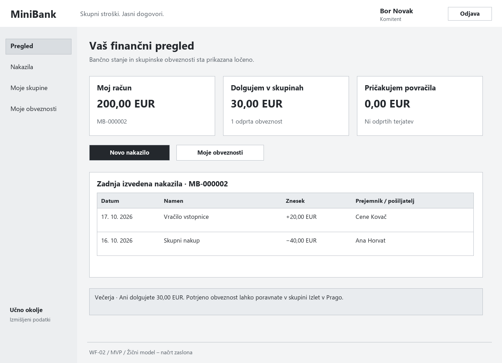

## WF-03 – Interno nakazilo

Povezana zgodba: US-02.

Uporabnik izbere svoj račun ter vnese prejemnika, znesek in namen. Nakazila nad 500 EUR čakajo na odobritev; skupinski dolg se poravna prek njegovega gumba »Poravnaj«.

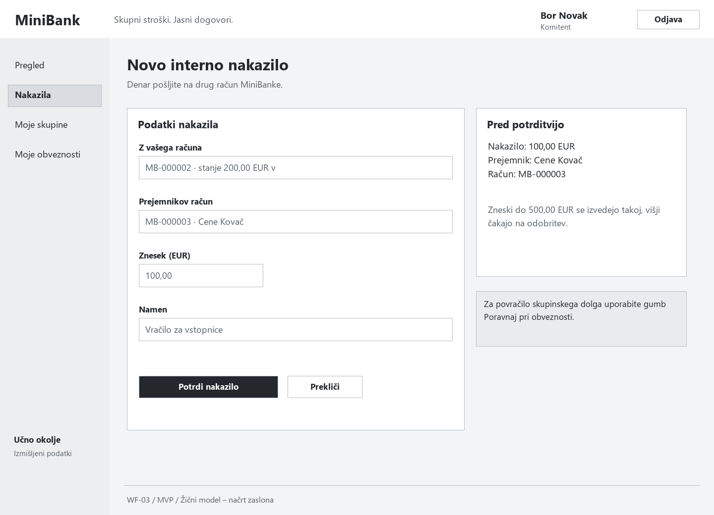

## WF-04 – Skupine in povabila

Povezana zgodba: US-03.

Uporabnik vidi svoje skupine, ustvari novo ali odgovori na povabilo. Organizator lahko povabi druge komitente, povabljeni pa dobi dostop do stroškov šele po sprejemu.

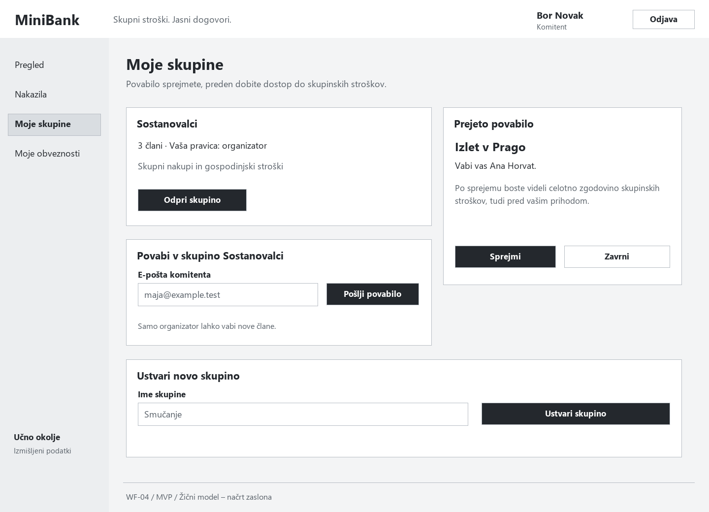

## WF-05 – Skupinske obveznosti

Povezana zgodba: US-06.

Pregled pokaže, kdo komu dolguje, koliko in ali je dolg že poravnan. Uporabnik lahko plača samo svojo obveznost in ne vidi osebnih bančnih stanj drugih članov.

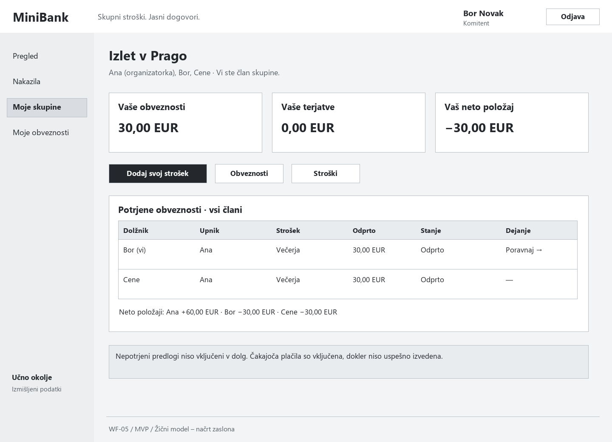

## WF-06 – Nov strošek

Povezana zgodba: US-04.

Plačnik vnese podatke stroška, izbere člane in enakomerno ali ročno delitev. Pred oddajo preveri vsoto deležev; sam vnos še ne prenese denarja.

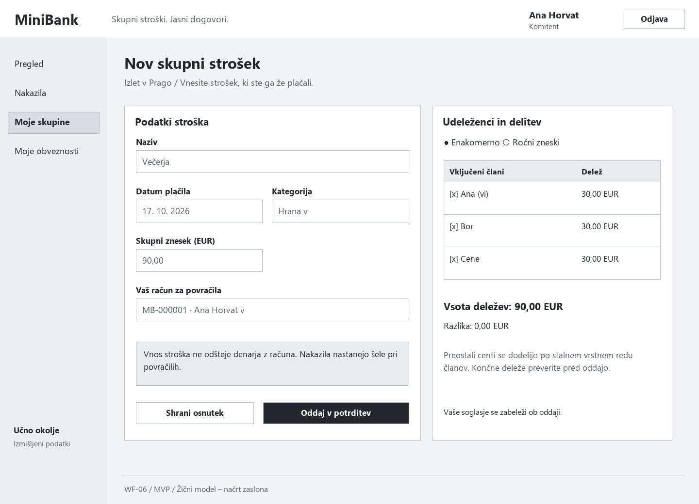

## WF-07 – Potrditev deleža

Povezana zgodba: US-05.

Član vidi predlog razdelitve in svoj delež, ki ga lahko potrdi ali zavrne z razlogom. Obveznosti nastanejo šele po soglasju vseh udeležencev.

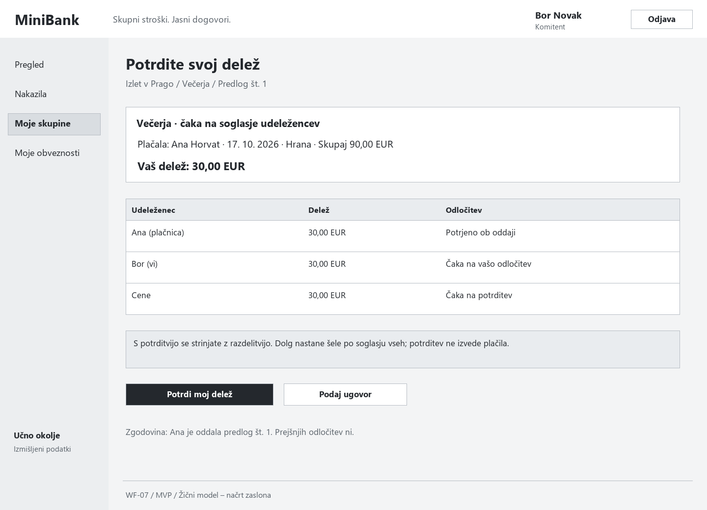

## WF-08 – Ugovor in popravek

Povezana zgodba: US-05.

Plačnik vidi razlog ugovora in pripravi nov predlog ali strošek prekliče. Pri novem predlogu morajo udeleženci deleže ponovno potrditi, stari odgovori pa ostanejo v zgodovini.

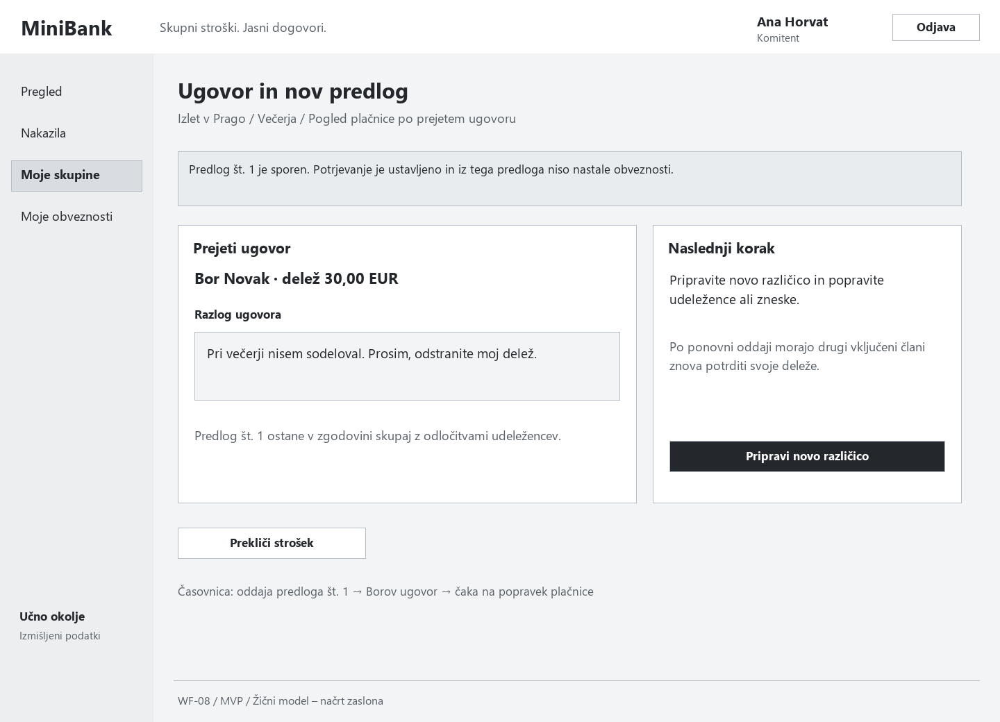

## WF-09 – Poravnava obveznosti

Povezana zgodba: US-07.

Dolžnik preveri prejemnika in znesek, izbere svoj račun ter potrdi plačilo. Dolg je poravnan šele po uspešnem nakazilu; med čakanjem na odobritev novega plačila ni mogoče oddati.

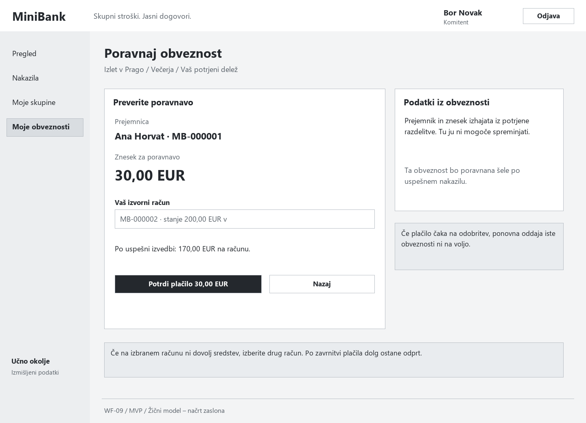

## WF-10 – Obravnava nakazila

Povezana zgodba: US-16.

Bančni uslužbenec pregleda čakajoče nakazilo in ga odobri ali zavrne z razlogom. Ob odobritvi se sredstva ponovno preverijo, odločitev pa se shrani v zgodovino.

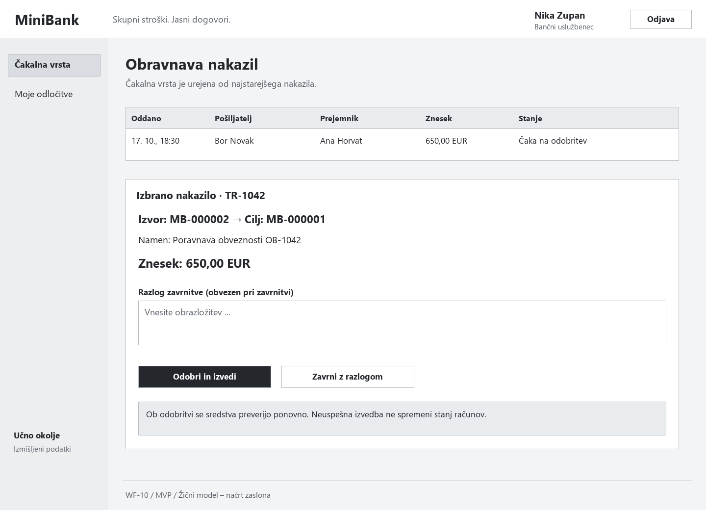

## WF-11 – Upravljanje uporabnikov

Povezana zgodba: US-17.

Administrator ustvarja dostope, določa vloge in aktivira ali deaktivira uporabnike. Finančnih podatkov ne vidi, zadnjega aktivnega administratorja pa ne more deaktivirati.

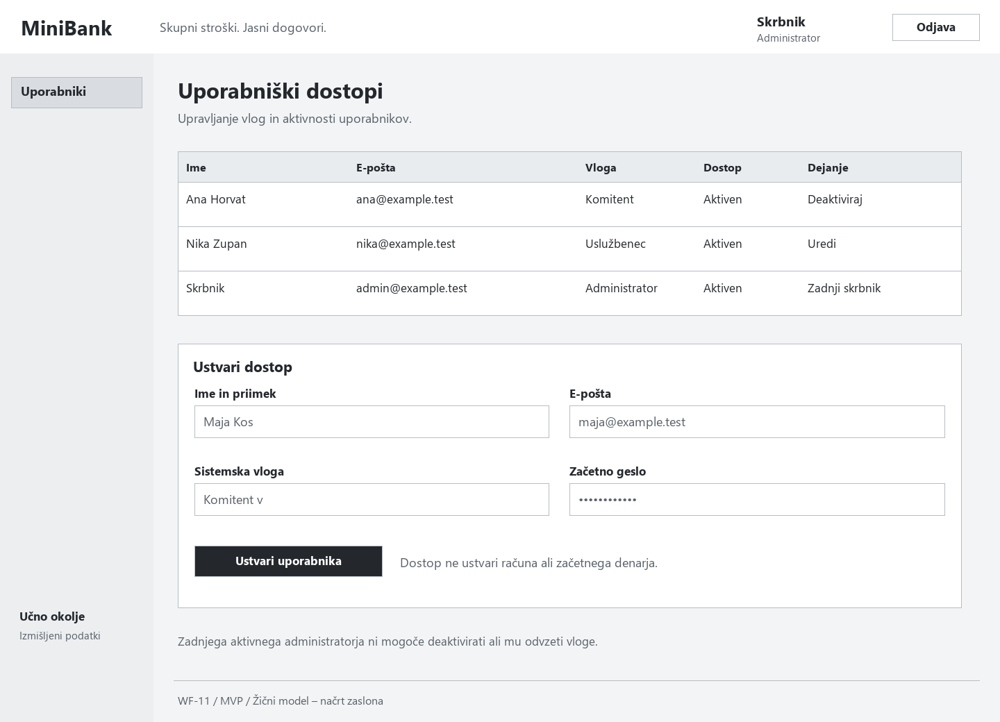

## WF-12 – Poenostavitev poravnav (kasnejša nadgradnja)

Povezana zgodba: US-08.

Zaslon primerja trenutna nakazila s predlogom, ki jih zmanjša. Na primer: namesto Ana → Bor in Bor → Cene lahko Ana plača neposredno Cenetu. Spremembo morajo potrditi vsi prizadeti člani; potrditev predloga še ne izvede plačila.

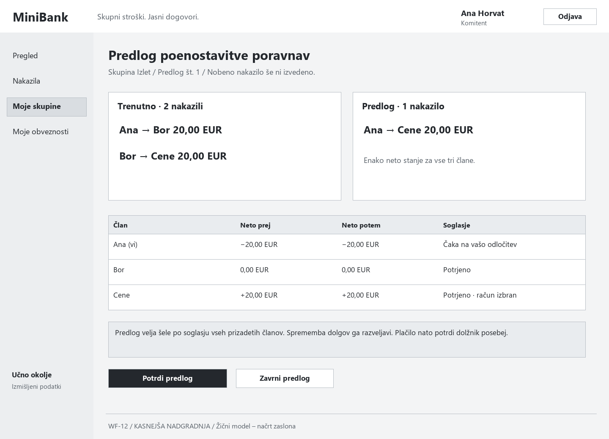

## Osnovni potek

Uporabnik se prijavi, odpre skupino in vnese strošek. Člani potrdijo deleže, nato dolžniki poravnajo svoje obveznosti. Ugovor vrne predlog plačniku v popravek, nakazilo nad 500 EUR pa obravnava bančni uslužbenec.

Napake in stanja so prikazani z besedilom. Pri praznem seznamu je navedeno, da še ni podatkov. Vmesnik se bo prilagajal tudi ožjim zaslonom. Slike za ostale kasnejše nadgradnje bodo pripravljene pred njihovo izvedbo.
